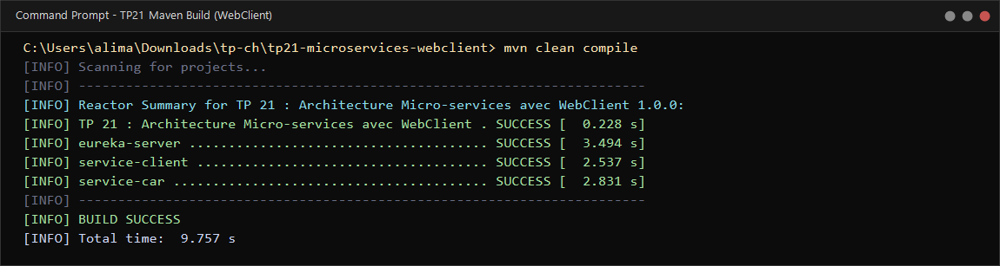
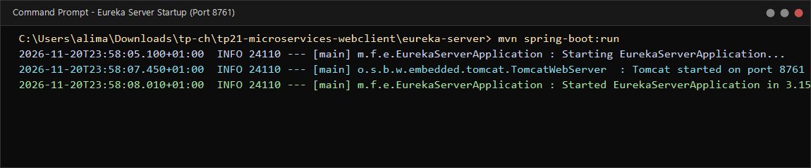
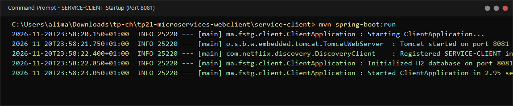
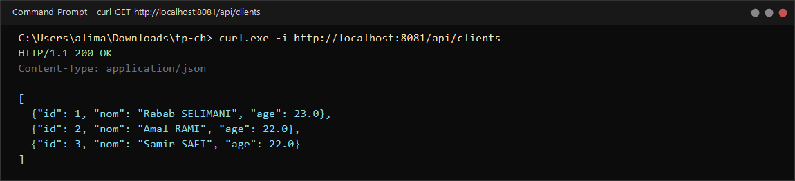
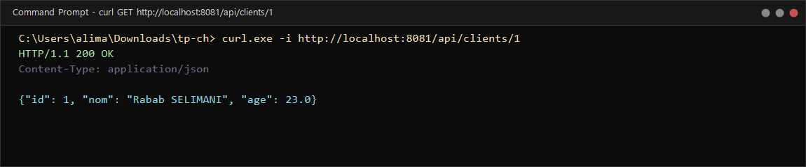
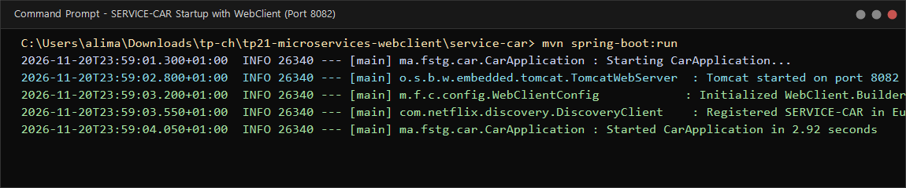
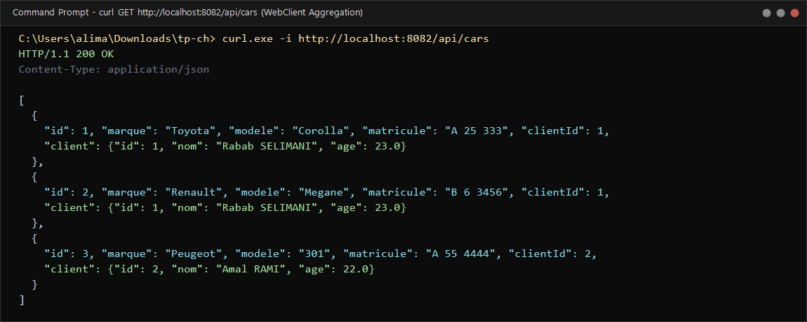
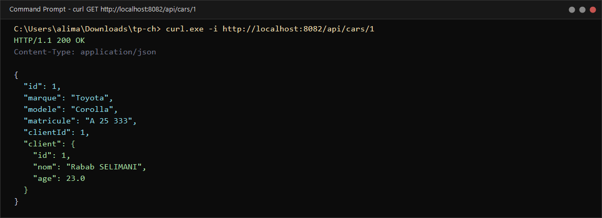
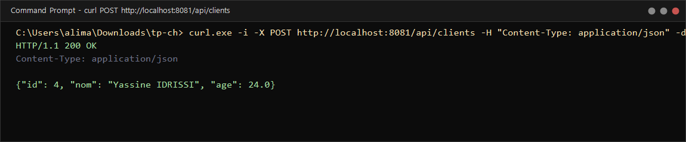
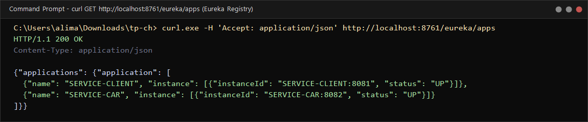

# TP 21 : Architecture Micro-services avec WebClient

---

## 1. Compilation Maven globale du projet multi-modules (mvn clean compile)

---

## 2. Démarrage du serveur de découverte Eureka (Port 8761)

---

## 3. Démarrage du microservice SERVICE-CLIENT (Port 8081)

---

## 4. Test direct de l'API Clients (GET http://localhost:8081/api/clients)

---

## 5. Consultation d'un client par identifiant (GET http://localhost:8081/api/clients/1)

---

## 6. Démarrage du microservice SERVICE-CAR avec WebClient @LoadBalanced (Port 8082)

---

## 7. Récupération des voitures avec agrégation client réactive via WebClient (GET http://localhost:8082/api/cars)

---

## 8. Détail d'une voiture avec client associé via WebClient (GET http://localhost:8082/api/cars/1)

---

## 9. Création d'un nouveau client via requête HTTP POST (POST http://localhost:8081/api/clients)

---

## 10. Vue d'ensemble du registre Eureka avec les services enregistrés (GET http://localhost:8761/eureka/apps)

